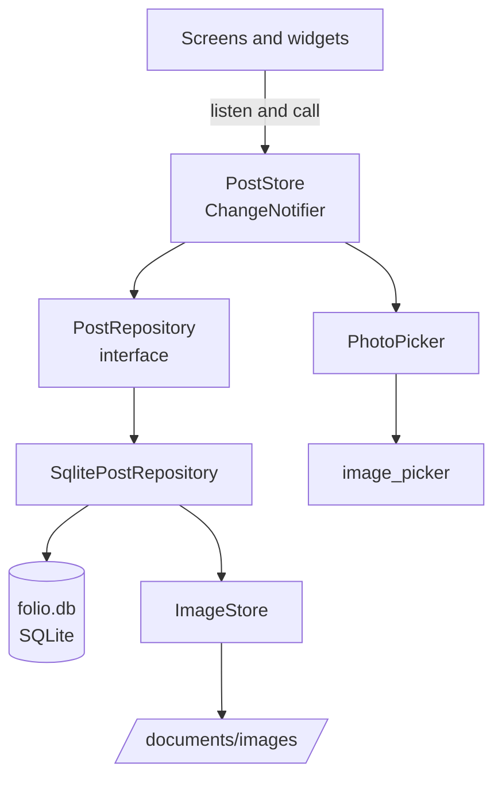
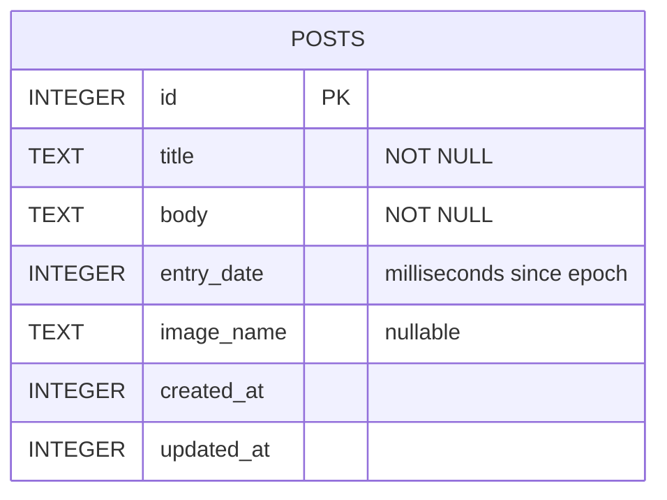
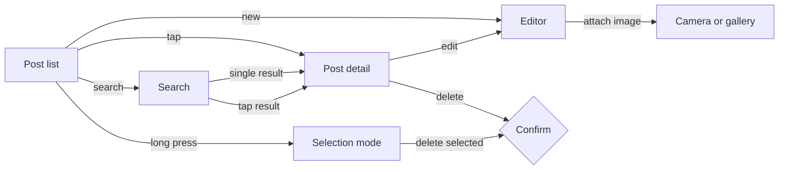

# Folio architecture

Folio is an offline blogging client built with Google Flutter for Android and iOS. This document describes how the application is organised, how its layers depend on one another, how blog items and their images are stored on the device, and how the user moves between its screens. The functional specification, the design diagrams, the test results and the log of development decisions are kept in separate documents under `docs/`, and each is referenced where it applies.

## 1. Requirements overview

The user requirements define a single kind of record, the blog item, which carries a title, a date of entry, a main body of text and an image. The application must let the user create, view, edit and delete these items, delete a chosen group of them in one action, view the full list, and search the text of all items to show either the first match or a list of matches. Items must be stored in a file or database on the device, images must be attachable from both the camera and the photo gallery, and every function must work when the device has no network connection.

Two constraints shape the engineering as much as the features do. The code must remain portable between Android and iOS, and the project must rebuild on a standard Android Studio installation without additional dependencies, which means every package the application uses has to be necessary and justified. Section 5 sets out that justification.

## 2. Repository structure

```
folio-blog/
├── README.md
├── ARCHITECTURE.md
├── docs/
│   ├── SPECIFICATION.md
│   ├── DESIGN.md
│   ├── TESTING.md
│   └── DECISIONS.md
├── lib/
│   ├── main.dart
│   ├── app.dart
│   ├── models/
│   │   └── post.dart
│   ├── data/
│   │   ├── blog_database.dart
│   │   ├── photo_picker.dart
│   │   ├── post_repository.dart
│   │   ├── sqlite_post_repository.dart
│   │   └── image_store.dart
│   ├── state/
│   │   └── post_store.dart
│   ├── screens/
│   │   ├── post_list_screen.dart
│   │   ├── post_detail_screen.dart
│   │   ├── post_editor_screen.dart
│   │   └── search_screen.dart
│   ├── widgets/
│   │   ├── post_tile.dart
│   │   ├── post_image.dart
│   │   ├── image_source_sheet.dart
│   │   ├── highlighted_text.dart
│   │   ├── empty_state.dart
│   │   └── confirm_delete_dialog.dart
│   ├── theme/
│   │   └── app_theme.dart
│   └── util/
│       ├── date_text.dart
│       └── search_query.dart
├── test/
├── integration_test/
├── android/
├── ios/
├── pubspec.yaml
└── analysis_options.yaml
```

| Path | Responsibility |
|---|---|
| `README.md` | Overview of the application, build and run steps, and an index of the documentation |
| `ARCHITECTURE.md` | Structure, layers, storage and screen flow of the application |
| `docs/SPECIFICATION.md` | Software functional specification, with each requirement traced to the user requirements |
| `docs/DESIGN.md` | Software design document, including the UML class diagram, sequence diagrams, screen flow and database schema |
| `docs/TESTING.md` | Test plan and recorded results for every implemented function |
| `docs/DECISIONS.md` | Major development decisions, the alternatives considered, and the issues met during development with their resolutions |
| `lib/main.dart` | Entry point, which opens the database and starts the application |
| `lib/app.dart` | Root widget, theme selection and navigation routes |
| `lib/models/` | The `Post` value class and its conversion to and from database rows |
| `lib/data/` | All access to SQLite, the file system and the camera and gallery, behind the `PostRepository` interface and the `PhotoPicker` class |
| `lib/state/` | `PostStore`, which holds the list of posts, the current selection and the search results, and notifies the screens when they change |
| `lib/screens/` | The four screens of the application |
| `lib/widgets/` | Reusable interface components shared between screens |
| `lib/theme/` | Colours, type scale and component styles for the light and dark themes |
| `lib/util/` | Date formatting and search query handling, written in plain Dart |
| `test/` | Unit and widget tests, run with `flutter test` |
| `integration_test/` | End-to-end tests that run on a device against the real database |
| `android/`, `ios/` | Platform projects, including permissions and the camera and photo library usage descriptions |

## 3. Layered architecture

The application is divided into three layers, and each layer depends only on the one beneath it. The screens never touch SQLite or the file system directly. They read from and call into `PostStore`, which in turn works through the `PostRepository` interface, and only the classes in `lib/data/` know that a database and an image folder exist.



This separation is what allows the application to be tested at two levels. The widget tests replace the repository with an in-memory implementation and exercise the screens quickly and deterministically, while the integration tests run the same user flows on a device against the real database and file system.

State management uses `ChangeNotifier` and `ListenableBuilder`, both of which are part of the Flutter SDK. They keep the reactive list, the selection mode and the search results in one place without adding a state management package, which suits an application of four screens and keeps the dependency list to what the features require.

## 4. Data storage

### 4.1 Database schema

Blog items are stored in a SQLite database named `folio.db` in the application's documents directory, in a single table.



The table is indexed on `entry_date`, because the list is always presented with the most recent entry first. The date of entry is a field the user controls, chosen through a date picker that defaults to the current day, and it is kept separate from `created_at` and `updated_at`, which record when the item was first saved and last changed and are never edited by the user.

### 4.2 Image storage

The `image_name` column holds only the name of the image file, never its full path. On iOS the absolute path to an application's container changes between installations and with some updates, so a stored full path would eventually point to nothing, whereas a file name resolved against the documents directory at the moment it is needed remains valid.

When the user takes a photo or chooses one from the gallery, `image_picker` returns a temporary file that the operating system may remove at any time. `ImageStore` therefore copies it into the `images/` folder under a generated name the moment the post is saved, before the database row is written, and the post records that name. Holding the temporary path until then means that a draft the user abandons leaves no file behind. When an image is replaced, the previous file is deleted after the new one has been saved, and when a post is deleted, alone or as part of a group, its image file is deleted in the same operation, so the device does not accumulate unused photos. Images are limited to 1600 pixels on the longer edge at a quality of 85, which keeps a typical photo under one megabyte while remaining sharp on a phone screen.

On Android, the system may close the application while the camera is open if the device is short of memory, and in that case the captured photo can only be recovered through `retrieveLostData`. The post list checks for lost data each time the application starts and, when a photo is found, opens a new draft holding it, and the handling of this case is recorded in `docs/DECISIONS.md`.

## 5. Dependencies

| Package | Purpose | Justification |
|---|---|---|
| `sqflite` | SQLite database on Android and iOS | Access to SQLite requires native code on each platform, and sqflite is the standard maintained plugin for it |
| `path_provider` | Location of the application documents directory | The directory is in a different place on each platform and can only be found through the native side |
| `image_picker` | Camera capture and gallery selection | Equivalent native camera and photo library code in Kotlin and Swift would add considerable complexity and risk for the same result |
| `path` | Safe joining of file paths | Already required by sqflite, and declared directly because the application imports it |

All other functionality, including date formatting, search highlighting and theming, is written in plain Dart. The testing packages `flutter_test` and `integration_test` are part of the Flutter SDK and are not additional dependencies.

## 6. Search

Search runs a case-insensitive `LIKE` query across the title and body of every item, with the characters `%` and `_` escaped so that they are matched literally rather than treated as wildcards. `LIKE` was chosen over SQLite's FTS5 full-text extension because FTS5 is not guaranteed to be available in the system SQLite of older Android versions, and for the number of entries a personal blog holds on a phone an indexed scan returns results without perceptible delay. Results are shown as a list with the matching text highlighted, and when exactly one item matches the application opens it directly, which satisfies the requirement to display either the first matching item or a list of matching items.

## 7. Screens and navigation



| Screen | Purpose |
|---|---|
| Post list | Shows every item, newest first, with a thumbnail, title, date and a two-line excerpt. A long press enters selection mode for group deletion |
| Post detail | Shows a single item in full, with the image across the width of the screen, and offers edit and delete actions |
| Editor | Creates a new item or edits an existing one, with fields for title, date of entry and body, and an image that can be taken with the camera or chosen from the gallery |
| Search | Searches the title and body of all items as the user types and lists the matches |

In selection mode the app bar shows the number of items selected, together with actions to select all and to delete. Every deletion, single or grouped, asks for confirmation and states how many items will be removed, because a deleted item and its image cannot be recovered.

## 8. Interface design

The interface uses Material 3 components with a custom theme, so that it looks consistent on Android and iOS without imitating either platform. Surfaces are flat and solid, with a single accent colour, no gradients and generous spacing, and images are the only rich element on the screen. Light and dark themes are both supported and follow the device setting. Every state that would otherwise show a blank screen, such as an empty list, a search with no results or an item without an image, has a designed empty state that tells the user what to do next.

## 9. Offline operation

The application has no network code, and the main Android manifest does not declare the `INTERNET` permission. Flutter adds that permission only to the debug and profile manifests, for development tooling, so the release build cannot open a network connection at all. All functions were tested with the device in airplane mode on both platforms, and the results are recorded in `docs/TESTING.md`.

## 10. Documentation set

| Assessment component | Document | Contents |
|---|---|---|
| Project plan | `ARCHITECTURE.md`, section 11 | Phases of work and their dates |
| Functional specification | `docs/SPECIFICATION.md` | Functional and non-functional requirements, traced to the user requirements, with the check for each |
| Design document | `docs/DESIGN.md` | UML class diagram, sequence diagrams for saving an item and for group deletion, screen flow and database schema |
| Test results | `docs/TESTING.md` | Test cases mapped to each requirement, with unit, widget, integration and manual device results |
| Decisions and issues | `docs/DECISIONS.md` | Each major decision with the alternatives considered, and each significant issue with its resolution |

The combined supporting document submitted in Word or PDF format summarises these files within the required length of around 500 words.

## 11. Project plan

| Date | Phase |
|---|---|
| 26 October 2026 | Requirements analysis, functional specification, project setup and theme |
| 27 October 2026 | Post model, database schema, repository and data layer tests |
| 28 October 2026 | List, detail and editor screens with create, edit and delete |
| 29 October 2026 | Camera and gallery attachment, image storage and clean-up, recovery of lost camera data |
| 30 October 2026 | Search, group selection and deletion, empty states and dark theme |
| 31 October 2026 | Integration tests, offline testing on device, design and test documentation, final review |