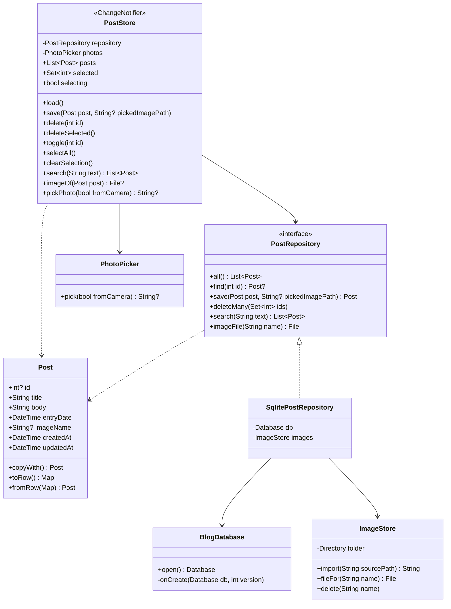
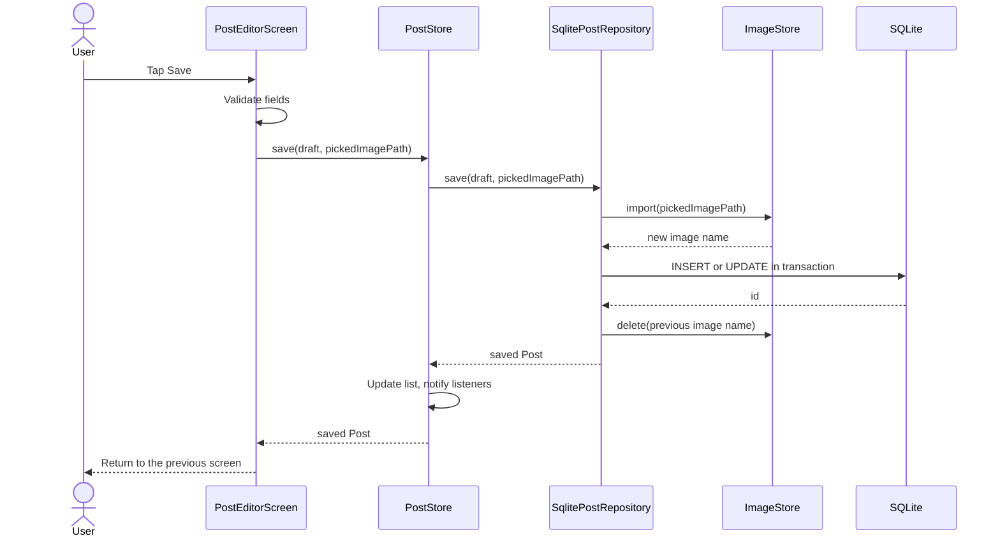
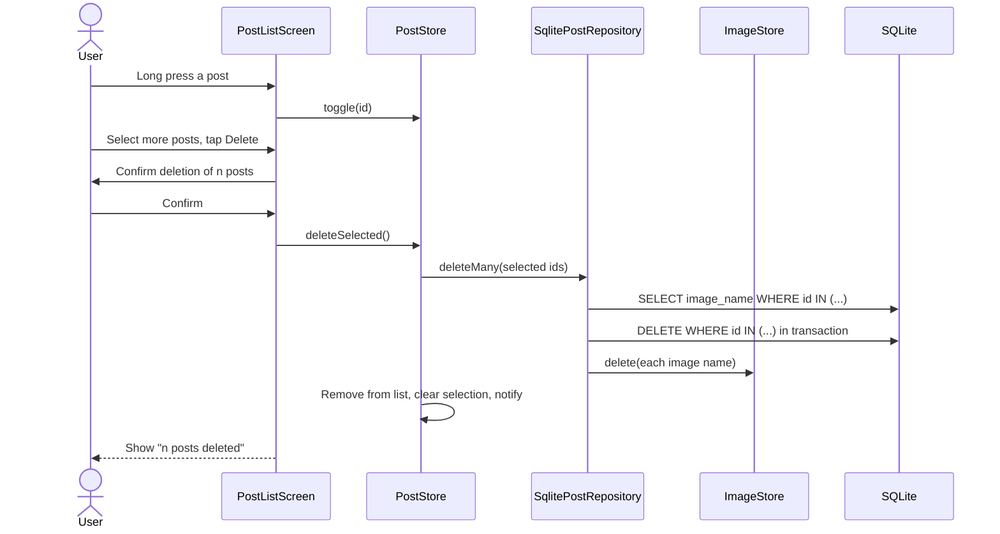
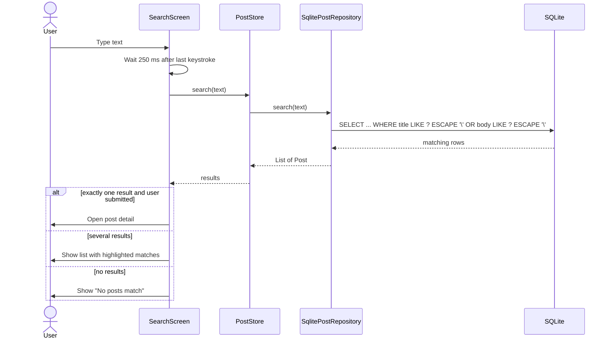
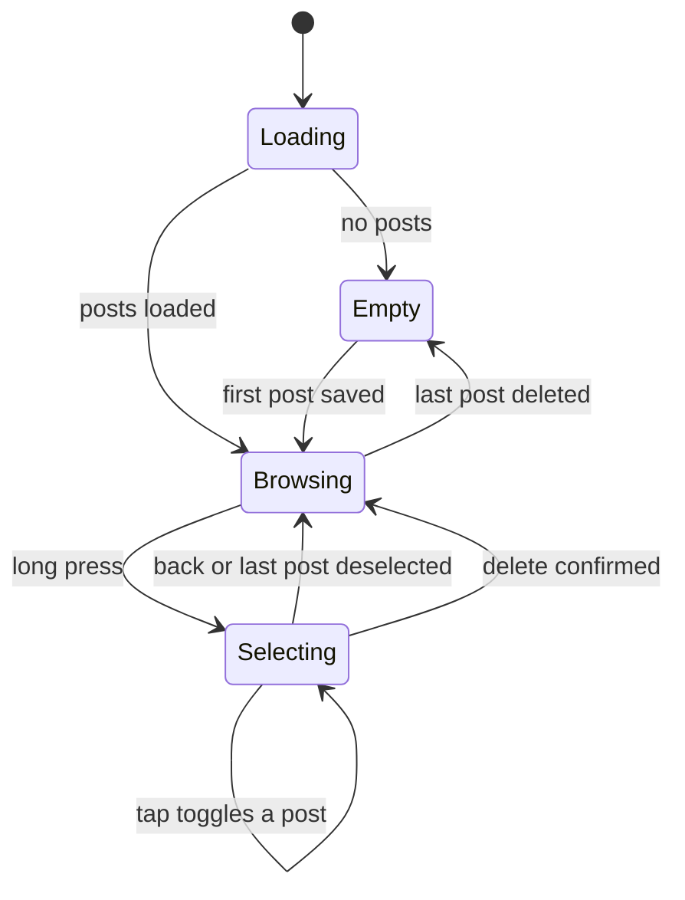
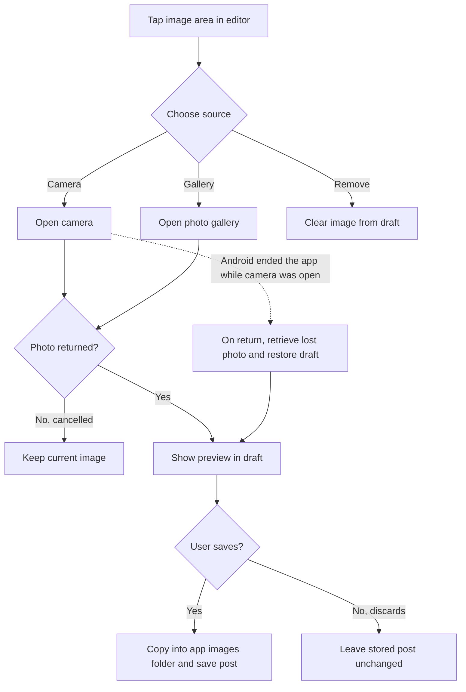

# Software design document

This document describes the design of the Folio offline blogging client using UML class and sequence diagrams, a state diagram, flow charts and the database schema. It builds on the layered structure set out in `ARCHITECTURE.md` and realises the requirements in `docs/SPECIFICATION.md`.

## 1. Design approach

The design follows a layered architecture with a single direction of dependency, from the screens to a state object, from the state object to a repository interface, and from the repository to the database and the file system. Each layer can be understood and tested without the layers above it, and the repository interface means the screens can be exercised against an in-memory implementation without a device.

## 2. Class diagram



`Post` is an immutable value class, and every change produces a new instance through `copyWith`, which keeps the editor's draft separate from the stored post until the user saves. `PostStore` is the only object the screens depend on, and it notifies its listeners whenever the list, the selection or the loading state changes, so every screen that shows posts stays consistent without manual refreshing.

## 3. Database schema

```sql
CREATE TABLE posts (
  id          INTEGER PRIMARY KEY AUTOINCREMENT,
  title       TEXT    NOT NULL,
  body        TEXT    NOT NULL,
  entry_date  INTEGER NOT NULL,
  image_name  TEXT,
  created_at  INTEGER NOT NULL,
  updated_at  INTEGER NOT NULL
);

CREATE INDEX idx_posts_entry_date ON posts (entry_date DESC);
```

Dates are stored as milliseconds since the Unix epoch, which sort correctly as integers and avoid any dependence on locale or time zone formatting in the database. The schema version is recorded through SQLite's `user_version`, so a later change to the table can be applied as a migration in `onUpgrade` without losing existing posts.

## 4. Sequence diagrams

### 4.1 Saving a post with a new image



The new image is copied into the application's folder before the database row is written, and the previous image is deleted only after the row has been saved. If the database write fails, the newly copied file is deleted and the stored post is left exactly as it was, so a failure never leaves a post pointing at a missing file.

### 4.2 Deleting a group of posts



The image names are read before the rows are removed, and the files are deleted only after the transaction commits, so a failed deletion leaves both the posts and their images intact.

### 4.3 Searching



The short pause after the last keystroke keeps the screen responsive while the user is still typing, and opening a single match only when the user submits the search avoids the screen changing unexpectedly in the middle of typing.

## 5. State diagram of the post list



## 6. Flow chart for attaching an image



## 7. Screen design

| Screen | Layout | Actions |
|---|---|---|
| Post list | App bar with title and search action. Scrolling list of posts, each a row with a 64 pixel square thumbnail, title, date and two lines of excerpt. A floating button to write a new post | Tap opens a post. Long press starts selection mode. In selection mode the app bar shows the count, select all and delete |
| Post detail | Full-width image when present, followed by date, title and body in a readable column | Edit and delete in the app bar |
| Editor | Image area at the top showing the preview or a prompt to add a photo, then title field, date field that opens a date picker, and a multi-line body field | Save in the app bar. Tapping the image area opens a sheet with Camera, Gallery and Remove |
| Search | Search field in the app bar with focus on open, results below with the matching text highlighted | Tap a result to open it. Submitting with one result opens it directly |

The visual language is flat, with solid surfaces, a single accent colour, no gradients, and type sized for comfortable reading of longer posts. Empty states use a short message and a single action, and confirmation dialogs name the number of posts affected.
